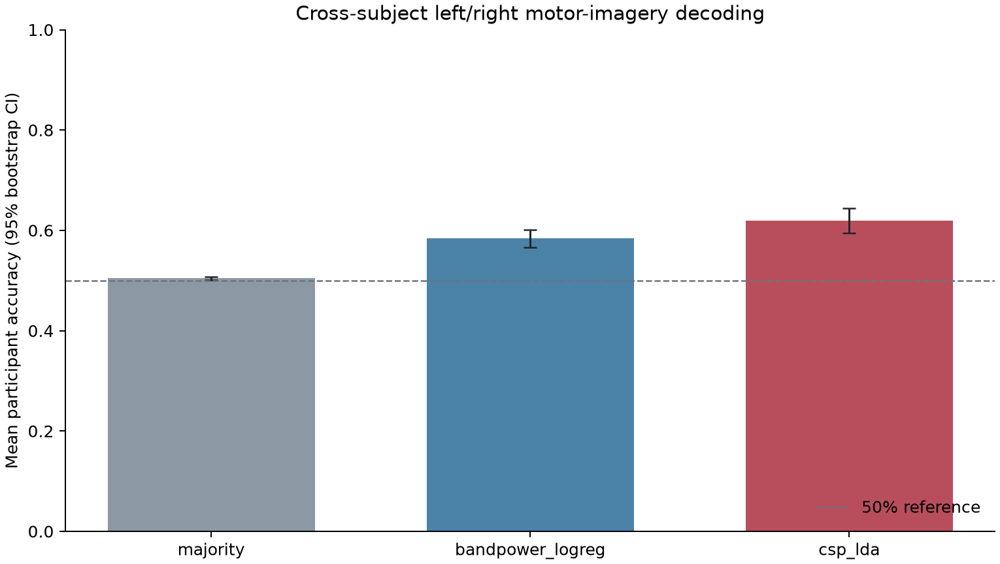
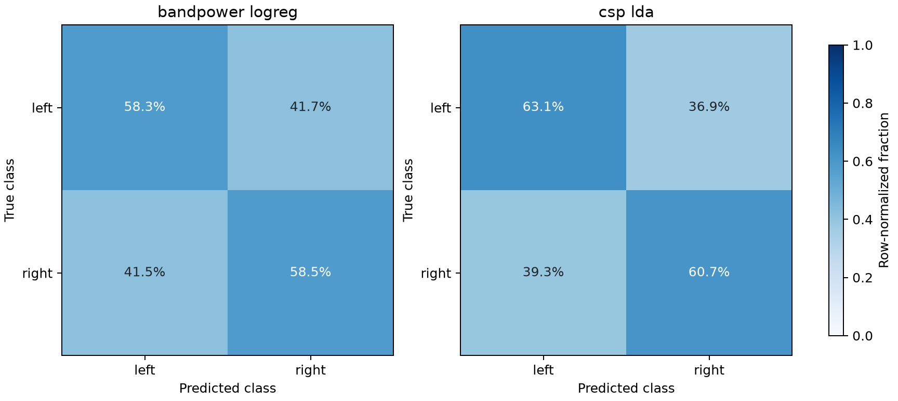

# EEG Analysis using AI/ML — Full-cohort results

**Status:** completed reproducible software analysis; research results are exploratory and non-clinical.
**Run date:** 2026-10-14 (UTC).

## Research question

How do two classical feature-based baselines compare with a majority-class reference for left-versus-right hand motor-imagery classification when test participants are unseen during training?

## Dataset and scope

The analysis uses 104 participants from the PhysioNet EEG Motor Movement/Imagery Database v1.0.0, runs 4, 8, and 12, 64 EEG channels, and 4680 task epochs sampled at 160 Hz. Runs 4, 8, and 12 contain left-versus-right hand motor imagery. T1 is mapped to left imagery and T2 to right imagery. Five participants were not included in the preselected 104-person cohort; the analysis does not infer why. All 312 EDF files used in this run were SHA-256 checked against the installed MNE-Python EEGBCI registry (zero mismatches). The raw recordings and per-file manifest are not redistributed here.

Dataset citation: Schalk, G. (2009). *EEG Motor Movement/Imagery Dataset (version 1.0.0).* PhysioNet. https://doi.org/10.13026/C28G6P. The dataset is distributed under the Open Data Commons Attribution License v1.0. The original BCI2000 paper should also be cited when reusing the dataset.

## Methods

Raw EDF files were read with MNE-Python, standardized to common channel names, band-pass filtered from 8 to 30 Hz, and epoched from cue onset through 3.99375 seconds (640 samples). Epochs annotated as bad by MNE were excluded. Each trial was demeaned per channel and scaled by its whole-trial RMS, without using labels or other trials.

Three methods were evaluated: a majority-class DummyClassifier; Welch mu (8–13 Hz) and beta (13–30 Hz) log-power features for each channel followed by standardization and L2 logistic regression; and shrinkage-regularized Common Spatial Patterns followed by shrinkage Linear Discriminant Analysis. Hyperparameters were fixed before the evaluation and were not tuned on test participants.

The test split unit was the participant. For each of three random seeds, all participants were partitioned into five disjoint folds. Each participant was tested exactly once per seed and never appeared in that seed's training data. Primary uncertainty is a 95% percentile bootstrap confidence interval over participant-level accuracies (10,000 resamples). The reported trial metrics average across seeds. No trial-level random split was used.

## Results

| Method | Participants | Folds | Seeds | Mean participant accuracy | 95% CI low | 95% CI high | Mean trial accuracy | Balanced accuracy | Macro F1 | ROC AUC |
| --- | --- | --- | --- | --- | --- | --- | --- | --- | --- | --- |
| majority | 104 | 5 | 3 | 0.504 | 0.501 | 0.508 | 0.504 | 0.500 | 0.335 | 0.496 |
| bandpower_logreg | 104 | 5 | 3 | 0.584 | 0.566 | 0.601 | 0.584 | 0.584 | 0.584 | 0.618 |
| csp_lda | 104 | 5 | 3 | 0.619 | 0.595 | 0.644 | 0.619 | 0.619 | 0.619 | 0.663 |


CSP-LDA minus band-power logistic regression mean participant-accuracy difference: 0.035 (participant-bootstrap 95% CI 0.016 to 0.056); exploratory paired Wilcoxon p=0.00208. This comparison is exploratory and was not preregistered.

The 50% line in the performance plot is a reference for a balanced two-class task, not a guarantee of chance-level performance for every metric. Results describe this dataset and pipeline only; they do not establish performance on a new population, equipment, or clinical task.





## Limitations

- The cohort is the available verified subset (104 of 109 dataset participants); five participant recordings were not present in the local verified cache used for this run.
- The two-class task uses motor-imagery runs only and does not compare motor execution with imagery.
- This is a classical baseline study, not a state-of-the-art decoder; model settings were fixed rather than nested-tuned.
- MNE annotation rejection does not remove every ocular, muscle, or movement artifact. The supplied recordings have no dedicated artifact-removal step in this analysis.
- Multiple runs from a participant are combined; the study estimates generalization to new participants, not to new sessions from known participants.
- The bootstrap interval summarizes participant variability for this cohort and does not account for all uncertainty in dataset selection or preprocessing.
- No diagnosis, treatment, or clinical performance claim is made.

## Reproduction

From this project directory, install `requirements.txt`, then run:

```bash
python scripts/run_analysis.py --data-root data/raw --out results/full_cohort --download-missing
```

When network access is unavailable, provide the existing MNE cache directory and omit `--download-missing`. The saved `run_info.json` records the versions and settings; aggregate result files intentionally omit participant-level prediction rows.
