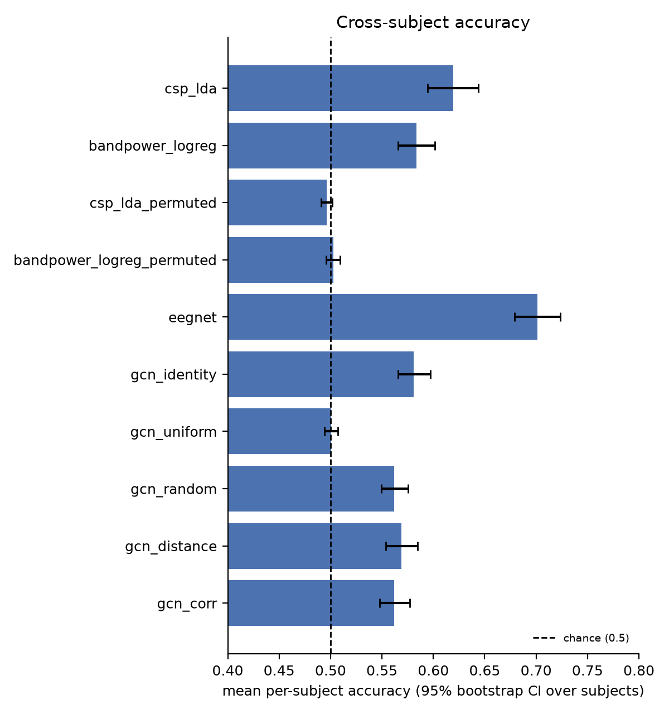
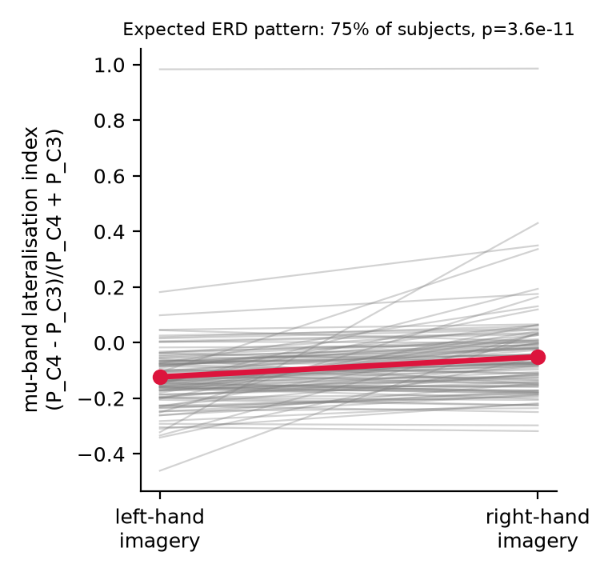

# Full-cohort EEG motor-imagery decoding report

**Researcher:** Krithika K · **Dataset:** PhysioNet EEG Motor Movement/Imagery Dataset (EEGMMIDB), v1.0.0<br>
**Analysis:** 104 eligible participants · 4,680 trials · five participant-wise folds · three random seeds<br>
**Report updated:** 13 October 2026<br>
**Code revision recorded by the data audit:** `34e42589aa4c0e1c540f9b4e631dc2ecf06265c5`

## Summary

This study compares classical classifiers, EEGNet, and electrode-graph neural networks for distinguishing imagined
left- versus right-fist movement in participants held out from model fitting. It uses all 104 participants retained
by the project's pre-specified exclusion list and dataset quality checks. Every held-out prediction, run setting,
dataset checksum, and generated summary is included in the accompanying [evidence package](../results/full_cohort/README.md).

Across the 104 held-out participants, EEGNet had the highest mean participant accuracy at 70.1% (95% participant-
bootstrap CI 67.9–72.4%), followed by CSP + LDA at 61.9% (59.4–64.4%). The distance-graph GCN reached 56.9%
(55.4–58.5%) and was 1.2 percentage points below the identity-graph control (58.1%; paired 95% bootstrap interval
for the difference −2.2 to −0.3 points; Holm-adjusted p = 0.053). This difference did not cross the 0.05 threshold
after correction, and the distance graph did not significantly differ from the random or correlation graph after
correction. The results therefore do not support a benefit from the tested spatial graph;
they do not establish that all graph methods fail. The label-shuffle controls were near chance. These estimates are
specific to this dataset, task, architecture, and fixed configuration.

All model metrics and corrected comparisons are generated from the completed out-of-fold predictions in
[`results/full_cohort/summary.csv`](../results/full_cohort/summary.csv) and
[`results/full_cohort/comparisons.csv`](../results/full_cohort/comparisons.csv). The numerical interpretation below
must be read together with the confidence intervals, multiple-comparison correction, and limitations described here.

## Question and hypotheses

**Question:** Does giving a neural network a spatial graph over EEG electrodes improve cross-participant decoding of
imagined left- versus right-fist movement, compared with classical pipelines, EEGNet, and matched graph controls?

The project hypotheses were:

1. A graph network would be at least competitive with EEGNet.
2. A graph built from electrode distance would outperform identity, uniform, and degree-matched random graph controls.
3. A training-data correlation graph might differ from the distance graph; this comparison is exploratory.

Null and negative findings are valid outcomes. This project does not make a clinical or diagnostic claim.

## Dataset and provenance

The source is PhysioNet's [EEG Motor Movement/Imagery Dataset](https://physionet.org/content/eegmmidb/1.0.0/),
version 1.0.0 (DOI [10.13026/C28G6P](https://doi.org/10.13026/C28G6P)). The analysis uses runs 4, 8, and 12,
which provide left- and right-fist motor-imagery cues. Participants 88, 89, 92, 100, and 104 were excluded because
of irregular annotations/timing under the project protocol. All remaining 104 participants passed sampling-rate,
channel, and minimum-trial checks.

| Dataset property | Value |
|---|---:|
| Eligible participants | 104 |
| Verified EDF recordings | 312 (three runs per participant) |
| Epochs | 4,680 (45 per participant) |
| EEG channels | 64 |
| Samples per epoch | 640 at 160 Hz (4 seconds) |
| Left / right cue trials | 2,360 / 2,320 |
| Signal band | 8–30 Hz |

EDF files were downloaded from the official public PhysioNet S3 mirror. Every file's SHA-256 matched the checksum
registry distributed with MNE-Python. The manifest and full audit are in
[`results/full_cohort/provenance/`](../results/full_cohort/provenance/). The audit records the source revision,
software versions, checksum manifest hash, and local cache hash. Raw EDF files and the large derived cache are not
redistributed in this repository. Follow the [PhysioNet dataset licence and citation terms](https://physionet.org/content/eegmmidb/1.0.0/);
the code's MIT licence does not apply to the EEG data.

## Signal preparation

The pipeline standardizes channel names, filters each recording from 8 to 30 Hz, combines the selected runs, and
extracts cue-locked epochs from 0 to 4 seconds. Voltage is converted from volts to microvolts. Each model input gets
per-trial DC removal and RMS scaling. These operations are applied independently to each trial and use no labels or
across-participant fitting statistics. No test participant is used to estimate a data-driven graph or choose model
weights.

An exploratory C3/C4 mu-band lateralization check is provided as a signal sanity check. It is not an independent
validation dataset, was not included in the model-comparison correction family, and cannot establish which features
the classifiers used.

## Models and controls

| Family | Method | Role |
|---|---|---|
| Classical | Common Spatial Patterns + Linear Discriminant Analysis (CSP + LDA) | Spatial-filtering baseline |
| Classical | Log mu/beta band power + logistic regression | Compact spectral baseline |
| Neural | EEGNet | Non-graph neural baseline |
| Graph | GCN with identity adjacency | No-edge control |
| Graph | GCN with uniform adjacency | Graph without spatially informative weights |
| Graph | GCN with degree-matched random adjacency | Randomized spatial-edge control |
| Graph | GCN with electrode-distance adjacency | Spatial graph under evaluation |
| Graph | GCN with training-only correlation adjacency | Data-driven exploratory graph |
| Sanity control | CSP + LDA and band-power logistic regression trained on shuffled labels | Label-shuffle canary |

The graph variants share the same architecture; only adjacency differs. The distance graph uses six nearest neighbors
under a Gaussian function of 3-D electrode distance. Correlation edges are estimated only from training-fold trials.
Adjacency matrices include self-loops and symmetric degree normalization. The code also supports phase-locking-value
graphs, but PLV was not included in this full-cohort run.

## Evaluation protocol

The outer evaluation is five-fold cross-validation over participants, repeated with seeds 0, 1, and 2. Each fold's
test participants are entirely absent from training and validation. Early stopping uses a validation subset drawn
from training participants only. The selected checkpoint is evaluated once on the held-out participants.

The primary metric is mean per-participant accuracy, averaging each participant's out-of-fold predictions across
seeds. Its 95% percentile confidence interval resamples participants (10,000 bootstrap draws). Trial-level accuracy,
balanced accuracy, macro-F1, ROC AUC, confusion matrices, and per-seed variability are secondary summaries. Paired
Wilcoxon signed-rank tests compare participant accuracies; p-values are adjusted with Holm's procedure across the
reported comparison set. These are descriptive model comparisons on one dataset, not evidence of broad generalization.

Deep-model configuration: up to 40 epochs, batch size 64, AdamW learning rate 0.001, weight decay 0.001, dropout
0.5, and patience 10. Early stopping selects the best validation accuracy, breaking ties by validation loss. The
recorded execution used CPU because CUDA and Apple MPS were unavailable; see each run's metadata for the environment.
No hyperparameter search was performed.

## Results

The primary metric is mean participant accuracy, averaged over the three seeds, with a percentile bootstrap interval
over the 104 participants. Trial-level metrics are averages across seeds. The table presents all ten methods; no
single fold or seed is used as the study result.

| Method | Mean participant accuracy (95% CI) | Mean trial accuracy | ROC AUC |
|---|---:|---:|---:|
| EEGNet | **70.1% (67.9–72.4%)** | 70.1% | 0.771 |
| CSP + LDA | 61.9% (59.4–64.4%) | 61.9% | 0.663 |
| Band-power logistic regression | 58.3% (56.6–60.1%) | 58.3% | 0.618 |
| GCN, identity control | 58.1% (56.6–59.7%) | 58.1% | 0.614 |
| GCN, electrode-distance graph | 56.9% (55.4–58.5%) | 56.9% | 0.593 |
| GCN, random graph | 56.2% (54.9–57.6%) | 56.2% | 0.588 |
| GCN, training-only correlation graph | 56.2% (54.8–57.7%) | 56.2% | 0.592 |
| GCN, uniform graph | 50.1% (49.4–50.7%) | 50.1% | 0.507 |
| CSP + LDA, shuffled training labels | 49.6% (49.1–50.2%) | 49.6% | 0.496 |
| Band-power logistic regression, shuffled training labels | 50.3% (49.6–50.9%) | 50.3% | 0.500 |



### Paired comparisons

The analysis script compared eleven model pairs and applied Holm correction across all eleven tests. The direct
distance-versus-correlation comparison was added during final review to cover the project's exploratory H3; it was
not pre-registered. Differences below are method *a* minus method *b*, computed from paired participant accuracies
averaged over seeds.

| Comparison | Mean difference (95% bootstrap interval) | Unadjusted p | Holm-adjusted p |
|---|---:|---:|---:|
| EEGNet − CSP + LDA | +8.2 points (+6.5 to +10.0) | <0.001 | <0.001 |
| Distance GCN − identity GCN | −1.2 points (−2.2 to −0.3) | 0.018 | 0.053 |
| Correlation GCN − identity GCN | −1.9 points (−2.9 to −0.9) | <0.001 | 0.003 |
| Random GCN − identity GCN | −1.9 points (−3.0 to −0.9) | <0.001 | 0.003 |
| Uniform GCN − identity GCN | −8.0 points (−9.6 to −6.5) | <0.001 | <0.001 |
| Distance GCN − random GCN | +0.7 points (−0.2 to +1.6) | 0.195 | 0.195 |
| Distance GCN − correlation GCN | +0.7 points (−0.05 to +1.36) | 0.056 | 0.112 |
| Distance GCN − EEGNet | −13.2 points (−15.2 to −11.3) | <0.001 | <0.001 |

The distance graph scored below the identity control, but this difference did not survive Holm correction (adjusted
p = 0.053). Neither distance-versus-random nor distance-versus-correlation was significant after correction. The
distance graph did exceed the uniform graph by 6.8 points (adjusted p < 0.001), but it showed no demonstrated
benefit over the no-edge identity or randomized graph controls in this experiment.
EEGNet exceeded CSP + LDA after correction, while the permutation canary remained near chance. Full comparison rows
are in `comparisons.csv`.

### Signal sanity check

The C3/C4 mu-band lateralization index is `LI = (P_C4 − P_C3) / (P_C4 + P_C3)`. The expected right-hand-versus-left-
hand direction appeared in 75% of participants. Mean LI was −0.1230 for left-hand imagery and −0.0509 for right-hand
imagery; paired Wilcoxon p = 3.63 × 10⁻¹¹. This is a group-level signal sanity check, not an independent validation
set and not evidence that a classifier relied on this physiology.



See the auto-generated [full-cohort summary](../results/full_cohort/summary.md),
[machine-readable metrics](../results/full_cohort/summary.csv),
[paired comparisons](../results/full_cohort/comparisons.csv), and
[figures](../results/full_cohort/figures/).

## Interpretation boundaries

- Participants are from one public dataset of healthy volunteers and one two-class imagery task.
- A held-out participant from this dataset is not an external-site or independent-dataset replication.
- Three seeds do not create additional independent participants; the participant sample is 104.
- One fixed architecture and configuration were evaluated without extensive tuning.
- Correlation between EEG electrodes can arise from volume conduction and does not establish anatomical connectivity.
- A near-chance or non-significant comparison is not proof that all graph methods fail; it is a result for these methods,
  data, and settings.
- The software and findings are not validated for diagnosis, treatment, clinical decisions, or real-time BCI use.

## Reproduction and evidence

The [evidence index](../results/full_cohort/README.md) describes each output and gives full reproduction commands.
In brief, from the project directory:

```bash
python scripts/download_physionet_verified.py
python scripts/make_data_figures.py --n-subjects 104
python scripts/run_baselines.py --n-subjects 104 --seeds 0 1 2 --out results/full_cohort/classical
python scripts/run_baselines.py --n-subjects 104 --seeds 0 1 2 --out results/full_cohort/classical_permuted --permute-train-labels
python scripts/run_deep.py --n-subjects 104 --seeds 0 1 2 --out results/full_cohort/deep --resume
python scripts/make_summary.py --results results/full_cohort
```

The repository includes held-out prediction CSVs, training histories, run metadata, the checksum manifest, dataset
audit, generated aggregate tables, and figures. Do not commit the downloaded EDFs or local cache.

## References

- PhysioNet. [EEG Motor Movement/Imagery Dataset, v1.0.0](https://physionet.org/content/eegmmidb/1.0.0/), DOI
  [10.13026/C28G6P](https://doi.org/10.13026/C28G6P).
- Lawhern et al. (2018). EEGNet: a compact convolutional neural network for EEG-based brain-computer interfaces.
  *Journal of Neural Engineering*, 15(5). [DOI](https://doi.org/10.1088/1741-2552/aace8c).
- Ramoser, Müller-Gerking & Pfurtscheller (2000). Optimal spatial filtering of single trial EEG during imagined hand
  movement. *IEEE Transactions on Rehabilitation Engineering*, 8(4). [DOI](https://doi.org/10.1109/10.842302).
- Kipf & Welling (2017). Semi-Supervised Classification with Graph Convolutional Networks. [ICLR paper](https://arxiv.org/abs/1609.02907).
- Gramfort et al. (2013). MEG and EEG data analysis with MNE-Python. *Frontiers in Neuroscience*, 7.
  [DOI](https://doi.org/10.3389/fnins.2013.00267).
