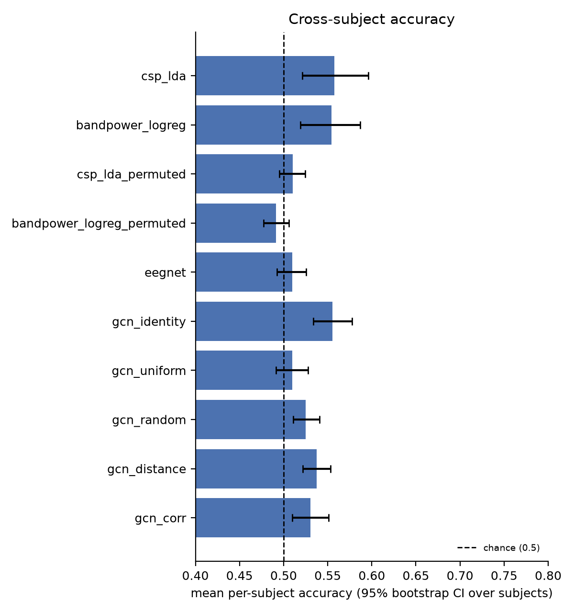
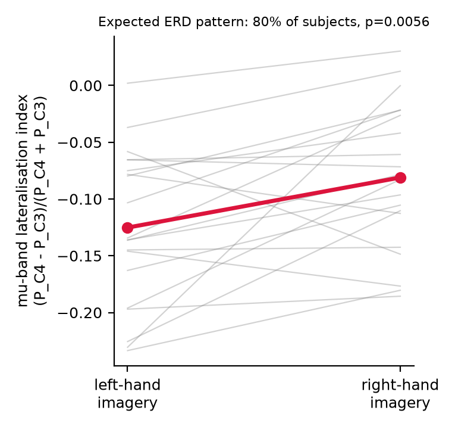

# Real-data pilot: cross-subject EEG motor-imagery decoding

**Author:** Krithika K · **Dataset:** PhysioNet EEGMMIDB v1.0.0 · **Analysis status:** completed exploratory pilot  
**Scope:** 20 participants · 900 trials · five subject-wise folds · three seeds  
**Source revision used for the runs:** 34e42589aa4c0e1c540f9b4e631dc2ecf06265c5

## Executive summary

This pilot evaluated whether electrode-graph neural networks improve left-versus-right fist motor-imagery decoding for participants held out from training. It used verified recordings from 20 participants, compared six neural models and four classical or label-shuffle baselines, and repeated the five-fold subject-wise evaluation with seeds 0, 1 and 2.

The strongest descriptive results were CSP + LDA at 55.8% mean per-participant accuracy (95% participant-bootstrap CI 52.1–59.6%) and the GCN identity control at 55.6% (53.4–57.7%). The distance-graph GCN reached 53.7% (52.1–55.3%). Its paired difference from the identity control was −1.8 percentage points; the Holm-adjusted p-value was 0.300. No reported model comparison was statistically significant after Holm correction. This pilot therefore does not provide evidence that the spatial distance graph improves cross-participant decoding.

These are exploratory estimates from the first 20 participants, not a full analysis of all eligible EEGMMIDB participants. The results do not support clinical or diagnostic use.

## Research question

For imagined left- versus right-fist movement, does a graph neural network that represents relationships among EEG electrodes improve prediction for people not used in training, compared with classical pipelines, EEGNet, and matched graph controls?

The directional hypotheses were recorded in the project README before the real-data runs. A null or negative outcome is reportable and does not invalidate the software contribution.

## Dataset and provenance

- **Source:** PhysioNet EEG Motor Movement/Imagery Dataset (EEGMMIDB), version 1.0.0, DOI 10.13026/C28G6P.
- **Subset:** participant IDs S001–S020; runs 4, 8 and 12, which contain left/right fist motor imagery.
- **Files:** 60 EDF recordings (three runs per participant). Every downloaded EDF passed SHA-256 validation against the checksum registry bundled with MNE-Python.
- **Loaded data:** 900 epochs, 64 EEG channels, 640 samples per epoch at 160 Hz; 455 left-cue trials and 445 right-cue trials. No participant in this subset was skipped.
- **Preprocessing:** 8–30 Hz zero-phase band-pass filter; epoch window 0–4 seconds; per-trial DC removal and whole-trial RMS normalization. No raw recordings or derived cache are included in the repository.
- **Audit trail:** [dataset audit](../results/real_data_pilot/provenance/dataset_audit.json), [EDF checksum manifest](../results/real_data_pilot/provenance/edf_manifest.csv). The preprocessed local cache SHA-256 is recorded in the audit.

The source data have an ODC Attribution License. Follow the [PhysioNet dataset terms and citation](https://physionet.org/content/eegmmidb/1.0.0/); the code's MIT licence does not apply to the EEG data.

## Evaluation and models

Each seed produced five outer folds. All trials from each held-out participant were kept out of model fitting, graph estimation, normalization across trials, and early stopping. A validation subset was selected from training participants only. Correlation graphs were estimated from training-fold trials only. The distance, identity, uniform, random and correlation GCN variants all had 6,498 trainable parameters; EEGNet had 2,898.

Models and controls:

1. Common Spatial Patterns + Linear Discriminant Analysis (CSP + LDA).
2. Log mu/beta band power + logistic regression.
3. EEGNet.
4. GCN with identity, uniform, degree-matched random, electrode-distance, or training-only correlation adjacency.
5. Label-shuffle canary: CSP + LDA and band-power logistic regression trained with shuffled training labels, evaluated on the original held-out labels.

Training used the committed default configuration: at most 40 epochs, batch size 64, AdamW learning rate 0.001, weight decay 0.001, dropout 0.5 and patience 10. The execution used CPU on macOS / Apple silicon. No hyperparameter search was performed.

## Results

Primary metric: mean per-participant accuracy, averaging each participant's out-of-fold predictions over the three seeds. Confidence intervals use a percentile bootstrap over the 20 participants. Trial-level metrics are averaged across seeds. The full table is in [summary.csv](../results/real_data_pilot/summary.csv); raw predictions and run settings are included beside it.

| Method | Participants | Seeds | Mean participant accuracy (95% bootstrap CI) | Mean trial accuracy |
|---|---:|---:|---:|---:|
| CSP + LDA | 20 | 3 | 55.8% (52.1–59.6%) | 55.8% |
| Band-power logistic regression | 20 | 3 | 55.4% (51.9–58.7%) | 55.4% |
| EEGNet | 20 | 3 | 51.0% (49.2–52.6%) | 51.0% |
| GCN, identity control | 20 | 3 | 55.6% (53.4–57.7%) | 55.6% |
| GCN, uniform graph | 20 | 3 | 51.0% (49.1–52.8%) | 51.0% |
| GCN, random graph | 20 | 3 | 52.5% (51.1–54.1%) | 52.5% |
| GCN, electrode-distance graph | 20 | 3 | 53.7% (52.1–55.3%) | 53.7% |
| GCN, training-only correlation graph | 20 | 3 | 53.0% (51.0–55.1%) | 53.0% |
| CSP + LDA, shuffled training labels | 20 | 3 | 51.0% (49.5–52.4%) | 51.0% |
| Band-power logistic regression, shuffled training labels | 20 | 3 | 49.1% (47.7–50.6%) | 49.1% |

### Paired comparisons

Per-participant paired Wilcoxon signed-rank tests were corrected across the reported comparisons using Holm's procedure. Every adjusted p-value was at least 0.084; none crossed the 0.05 threshold.

- Distance graph versus identity control: −1.8 percentage points (bootstrap interval −3.5 to −0.1), unadjusted p = 0.067, Holm-adjusted p = 0.300.
- Distance graph versus random graph: +1.2 points, adjusted p = 0.300.
- Distance graph versus CSP + LDA: −2.0 points, adjusted p = 0.401.
- CSP + LDA versus its label-shuffle control: +4.7 points, unadjusted p = 0.038, adjusted p = 0.300.

The label-shuffle results are near chance as expected for this canary. They are a pipeline sanity control, not a substitute for an independent replication or a formal test of all possible leakage.

### Signal sanity check

An exploratory C3/C4 mu-band lateralization check had the expected right-minus-left direction in 80% of participants. Mean lateralization index was −0.125 for left-hand imagery and −0.081 for right-hand imagery; paired Wilcoxon p = 0.0056. This supports that the selected recordings show a group-level motor-imagery lateralization pattern under this simple check. It is not an independent test set, was not part of the model-comparison correction family, and does not prove the models learned that physiology.

## Interpretation

The graph hypothesis was not supported in this pilot. The distance graph did not outperform the no-edge identity control, the random graph, or CSP + LDA after correction for multiple comparisons. Descriptively, CSP + LDA and the identity GCN were near 56%, while EEGNet and the graph controls were closer to chance. The permutation canary was also close to 50%.

This pattern is compatible with a difficult small-sample cross-participant decoding task and a fixed, untuned architecture. It does not establish that graphs never help EEG decoding. A larger participant sample, more robust hyperparameter selection, and external replication would be needed to test that broader claim.

## Reproducibility and evidence files

The result package includes out-of-fold trial predictions, per-epoch training histories, model run metadata, dataset provenance, generated tables, and figures. Raw EDF files and the 131 MB preprocessed cache are excluded.

- [Evidence index](../results/real_data_pilot/README.md)
- [Machine-readable summary](../results/real_data_pilot/summary.csv)
- [Paired comparisons](../results/real_data_pilot/comparisons.csv)
- [Auto-generated summary and figures](../results/real_data_pilot/summary.md)
- [Dataset audit and checksums](../results/real_data_pilot/provenance/)
- [Code, configuration and reproducibility instructions](../README.md)

From a fresh environment with the declared project dependencies, the same 20-participant pilot can be run with:

    python scripts/make_data_figures.py --n-subjects 20
    python scripts/run_baselines.py --n-subjects 20 --seeds 0 1 2 --out results/real_data_pilot/classical
    python scripts/run_baselines.py --n-subjects 20 --seeds 0 1 2 --out results/real_data_pilot/classical_permuted --permute-train-labels
    python scripts/run_deep.py --n-subjects 20 --seeds 0 1 2 --out results/real_data_pilot/deep --resume
    python scripts/make_summary.py --results results/real_data_pilot

The dataset loader may download data on first use. Follow the PhysioNet licence and do not commit EDFs or the derived data cache.

## Limitations and next research steps

- This is a 20-participant subset of a 109-volunteer dataset, not the full eligible-cohort experiment.
- Three seeds improve stability checks but do not create more independent participants; the participant-level sample remains 20.
- One public dataset, healthy volunteers and a two-class imagined-movement task limit generalization.
- Models and hyperparameters were fixed rather than extensively tuned; CPU resource limits also shaped the pilot size.
- Correlation edges may reflect volume conduction and are not direct measures of anatomical connectivity.
- No clinical, diagnostic, therapeutic or real-time BCI claim is supported.

Next steps are to expand the participant cohort, pre-specify any additional model selection, and replicate on an independent dataset before making broader scientific claims.

## References

- PhysioNet. [EEG Motor Movement/Imagery Dataset, version 1.0.0](https://physionet.org/content/eegmmidb/1.0.0/). DOI: 10.13026/C28G6P.
- MNE-Python. [EEGBCI data loader and run descriptions](https://mne.tools/stable/generated/mne.datasets.eegbci.load_data.html).
- Lawhern et al. (2018). EEGNet: a compact convolutional neural network for EEG-based brain-computer interfaces. *Journal of Neural Engineering*, 15(5). [DOI](https://doi.org/10.1088/1741-2552/aace8c).
- Ramoser, Müller-Gerking & Pfurtscheller (2000). Optimal spatial filtering of single trial EEG during imagined hand movement. *IEEE Transactions on Rehabilitation Engineering*, 8(4). [DOI](https://doi.org/10.1109/10.842302).
- Kipf & Welling (2017). Semi-Supervised Classification with Graph Convolutional Networks. [ICLR paper](https://arxiv.org/abs/1609.02907).
