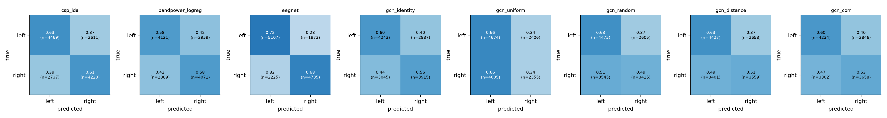

# Results summary (auto-generated by scripts/make_summary.py)

Protocol: subject-wise cross-validation (test subjects never seen in training). `subject_acc` = mean per-subject accuracy with 95% bootstrap CI over subjects; `trial_acc` = trial-level accuracy averaged over seeds.

| method | n_subjects | n_seeds | subject_acc | ci95_lo | ci95_hi | trial_acc | trial_acc_sd_over_seeds | balanced_acc | f1_macro | auc |
|---|---|---|---|---|---|---|---|---|---|---|
| csp_lda | 104 | 3 | 0.619 | 0.594 | 0.644 | 0.619 | 0.004 | 0.619 | 0.619 | 0.663 |
| bandpower_logreg | 104 | 3 | 0.583 | 0.566 | 0.601 | 0.583 | 0.002 | 0.583 | 0.583 | 0.618 |
| csp_lda_permuted | 104 | 3 | 0.496 | 0.491 | 0.502 | 0.496 | 0.003 | 0.496 | 0.496 | 0.496 |
| bandpower_logreg_permuted | 104 | 3 | 0.503 | 0.496 | 0.509 | 0.503 | 0.005 | 0.503 | 0.502 | 0.500 |
| eegnet | 104 | 3 | 0.701 | 0.679 | 0.724 | 0.701 | 0.002 | 0.701 | 0.701 | 0.771 |
| gcn_identity | 104 | 3 | 0.581 | 0.566 | 0.597 | 0.581 | 0.004 | 0.581 | 0.581 | 0.614 |
| gcn_uniform | 104 | 3 | 0.501 | 0.494 | 0.507 | 0.501 | 0.004 | 0.499 | 0.485 | 0.507 |
| gcn_random | 104 | 3 | 0.562 | 0.549 | 0.576 | 0.562 | 0.009 | 0.561 | 0.559 | 0.588 |
| gcn_distance | 104 | 3 | 0.569 | 0.554 | 0.585 | 0.569 | 0.001 | 0.568 | 0.567 | 0.593 |
| gcn_corr | 104 | 3 | 0.562 | 0.548 | 0.577 | 0.562 | 0.006 | 0.562 | 0.560 | 0.592 |

## Paired comparisons (Wilcoxon signed-rank on per-subject accuracy, Holm-corrected)

| a | b | n_subjects | mean_diff | diff_ci95_lo | diff_ci95_hi | p_value | p_holm |
|---|---|---|---|---|---|---|---|
| csp_lda | csp_lda_permuted | 104 | 0.123 | 0.098 | 0.148 | <0.001 | <0.001 |
| eegnet | csp_lda | 104 | 0.082 | 0.065 | 0.100 | <0.001 | <0.001 |
| gcn_distance | gcn_identity | 104 | -0.012 | -0.022 | -0.003 | 0.018 | 0.053 |
| gcn_corr | gcn_identity | 104 | -0.019 | -0.029 | -0.009 | <0.001 | 0.003 |
| gcn_uniform | gcn_identity | 104 | -0.080 | -0.096 | -0.065 | <0.001 | <0.001 |
| gcn_random | gcn_identity | 104 | -0.019 | -0.030 | -0.009 | <0.001 | 0.003 |
| gcn_distance | gcn_random | 104 | 0.007 | -0.002 | 0.016 | 0.195 | 0.195 |
| gcn_distance | gcn_uniform | 104 | 0.068 | 0.053 | 0.084 | <0.001 | <0.001 |
| gcn_distance | gcn_corr | 104 | 0.007 | -0.000 | 0.014 | 0.056 | 0.112 |
| gcn_distance | eegnet | 104 | -0.132 | -0.152 | -0.113 | <0.001 | <0.001 |
| gcn_distance | csp_lda | 104 | -0.050 | -0.072 | -0.029 | <0.001 | <0.001 |

## Figures

