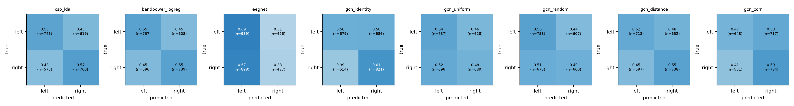

# Results summary (auto-generated by scripts/make_summary.py)

Protocol: subject-wise cross-validation (test subjects never seen in training). `subject_acc` = mean per-subject accuracy with 95% bootstrap CI over subjects; `trial_acc` = trial-level accuracy averaged over seeds.

| method | n_subjects | n_seeds | subject_acc | ci95_lo | ci95_hi | trial_acc | trial_acc_sd_over_seeds | balanced_acc | f1_macro | auc |
|---|---|---|---|---|---|---|---|---|---|---|
| csp_lda | 20 | 3 | 0.558 | 0.521 | 0.596 | 0.558 | 0.016 | 0.558 | 0.557 | 0.589 |
| bandpower_logreg | 20 | 3 | 0.554 | 0.519 | 0.587 | 0.554 | 0.001 | 0.554 | 0.554 | 0.573 |
| csp_lda_permuted | 20 | 3 | 0.510 | 0.495 | 0.524 | 0.510 | 0.011 | 0.510 | 0.505 | 0.502 |
| bandpower_logreg_permuted | 20 | 3 | 0.491 | 0.477 | 0.506 | 0.491 | 0.008 | 0.491 | 0.483 | 0.492 |
| eegnet | 20 | 3 | 0.510 | 0.492 | 0.526 | 0.510 | 0.007 | 0.508 | 0.484 | 0.509 |
| gcn_identity | 20 | 3 | 0.556 | 0.534 | 0.577 | 0.556 | 0.009 | 0.556 | 0.552 | 0.578 |
| gcn_uniform | 20 | 3 | 0.510 | 0.491 | 0.528 | 0.510 | 0.012 | 0.509 | 0.501 | 0.522 |
| gcn_random | 20 | 3 | 0.525 | 0.511 | 0.541 | 0.525 | 0.007 | 0.525 | 0.519 | 0.549 |
| gcn_distance | 20 | 3 | 0.537 | 0.521 | 0.553 | 0.537 | 0.020 | 0.538 | 0.535 | 0.555 |
| gcn_corr | 20 | 3 | 0.530 | 0.510 | 0.551 | 0.530 | 0.012 | 0.531 | 0.528 | 0.555 |

## Paired comparisons (Wilcoxon signed-rank on per-subject accuracy, Holm-corrected)

| a | b | n_subjects | mean_diff | diff_ci95_lo | diff_ci95_hi | p_value | p_holm |
|---|---|---|---|---|---|---|---|
| csp_lda | csp_lda_permuted | 20 | 0.047 | 0.007 | 0.090 | 0.038 | 0.300 |
| eegnet | csp_lda | 20 | -0.048 | -0.089 | -0.007 | 0.048 | 0.300 |
| gcn_distance | gcn_identity | 20 | -0.018 | -0.035 | -0.001 | 0.067 | 0.300 |
| gcn_corr | gcn_identity | 20 | -0.025 | -0.049 | -0.003 | 0.099 | 0.300 |
| gcn_uniform | gcn_identity | 20 | -0.046 | -0.074 | -0.019 | 0.008 | 0.084 |
| gcn_random | gcn_identity | 20 | -0.030 | -0.054 | -0.007 | 0.036 | 0.300 |
| gcn_distance | gcn_random | 20 | 0.012 | -0.003 | 0.027 | 0.117 | 0.300 |
| gcn_distance | gcn_uniform | 20 | 0.028 | 0.007 | 0.049 | 0.033 | 0.300 |
| gcn_distance | eegnet | 20 | 0.028 | 0.005 | 0.053 | 0.048 | 0.300 |
| gcn_distance | csp_lda | 20 | -0.020 | -0.056 | 0.015 | 0.401 | 0.401 |

## Figures

