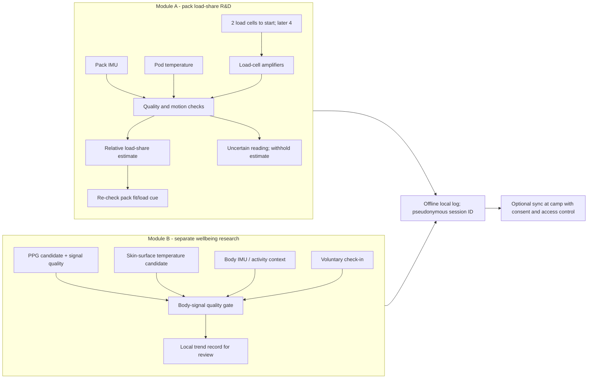

# Full Project Blueprint v1

**Prepared:** 18 November 2026  
**Project:** Himalayan Soldier Safety & Load Monitor (HSSM)  
**Status:** whole-system R&D concept; not a completed or field-tested device.

## 1. Project in one sentence

HSSM is a proposed offline, modular system for (A) measuring backpack load distribution and measurement quality, and (B) separately studying whether a wearable can record limited wellbeing trends with reliable signal-quality labels for a person and authorized support staff to review.

The two modules share a design goal—useful context without cloud dependence—but have different sensors, risks, and validation requirements. A single point cannot monitor the whole body. The project will not claim that it detects or prevents altitude illness, frostbite, organ damage, memory loss, mental illness, or injury.

## 2. What is known today

- The student reports owning one ESP32/Arduino controller. It is not connected to a load sensor.
- The Python demonstration uses synthetic signal-quality fields; it is not firmware for the pack hardware and is not a trained AI/ML model.
- There is no sensor rig, wearable, field data, human evaluation, or measured impact yet.
- DRDO publicly lists high-altitude acclimatization monitoring/prediction, a wearable sweat-analysis fatigue device, and military load-carriage work. Public evidence therefore does not support “India has no soldier monitoring” or “no solution exists.”
- Published patent and research prior art covers backpack load/strap sensing, balance alerts, motion-aware pack measurement, and quality-gated carrier-load estimation. The current design has no established novelty claim.

## 3. Complete system architecture

This diagram is a concept, not a tested circuit or product. Module A can be tested on a dummy pack without health or clinical work. Module B remains a separate research stream until its intended use, sensor placement, data quality, and oversight are settled.

## 4. Module A — backpack load-share monitor

### Problem being tested

Can a removable retrofit measure left/right load share at the backpack support path on a defined dummy-pack fixture, repeatably enough to help a user re-check pack placement, while withholding the estimate when sensor data are faulty?

This does not measure total burden reduction, tissue pressure, injury risk, fatigue, or health.

### Hardware roadmap

**Bench POC:**

- 2 matching load cells at left/right shoulder load paths. For direct strap tension, shortlist S-type tension/compression cells with a documented range, output, excitation voltage, mounting dimensions, and operating/compensated temperature range. Select capacity only after the fixture and maximum test force are reviewed.
- 2 HX711 amplifier modules, one per measurement channel, or a better-specified equivalent after the chosen sensor is known.
- Existing ESP32/Arduino board, powered over USB; exact board model and logic levels must be confirmed.
- One frame IMU only after static two-channel measurements work; use it to label movement context, not infer fatigue or injury.
- Optional pod-temperature sensor for later controlled hardware drift testing. It must not be described as a body/core-temperature sensor.
- Status LED and raw local log first. Battery, haptic alert, hip points, enclosure, and cold testing are later gates.

**Expansion:** move to four shoulder/hip channels only if the 2-channel rig is mechanically sound and repeatable. Keep the mount removable; never alter issued equipment without authorization.

### Output rules

- Valid, tested range: display a relative load-share estimate and “re-check pack placement” when the agreed engineering rule is crossed.
- Invalid data: mark “reading uncertain” and withhold the estimate.
- No “safe,” injury warning, fit-for-duty, medical all-clear, automatic strap movement, or claim that the pack became lighter.

## 5. Module B — separate wearable wellbeing research

The initial wearable research question is whether a small, offline sensor node can collect a few signal trends with an explicit signal-quality flag. It is not “whole-body monitoring.”

### Candidate scope, subject to review

- PPG: candidate for heart-rate trend and optical signal-quality research. Cold, motion, poor contact, and peripheral perfusion can degrade readings. Do not present a student module's SpO2 or heart-rate output as clinical or high-altitude illness detection.
- Skin-contact temperature: optional trend only; it cannot substitute for core temperature or detect frostbite/organ damage.
- IMU: movement/rest context only.
- Mental wellbeing: voluntary self-report/check-in only. Do not infer depression, confusion, memory loss, or mental fitness from movement or heart-rate data.
- If user symptoms or concerning changes are ever studied, use clinician-approved wording and an approved research protocol; this is outside the current bench prototype.

### Module B build gate

Do not buy a set of physiological sensors until a qualified reviewer helps freeze the exact question and intended use. First compare candidate sensors on a bench/simulator, log raw signals and signal-quality failures, then assess whether any human study is necessary. If a human study collects physiological signals for biomedical or health research, obtain the applicable institutional ethics determination and informed consent; a bench or mechanical test does not itself require clinical testing. Active-service-member trials additionally require formal authorization. A “not for diagnosis” disclaimer alone does not settle regulatory classification if the intended purpose is disease or injury monitoring.

## 6. Shared software and AI/ML plan

**First version — transparent rules:** calibration, relative load-share calculation, sensor detach/saturation checks, a simple IMU movement flag, timestamps, local CSV logging, and a clear uncertain state. No trained ML model is currently justified.

**Later research:** only add ML after a specific non-diagnostic task is defined and enough permissioned, representative, labelled data exist. Freeze the test split before tuning; compare against the simple rules baseline; report false prompts, missed scripted cases, data gaps, and limitations. Never use synthetic rows as proof of human/soldier performance.

**Privacy:** no GPS or mission/route data in the student prototype. Use a random session identifier, collect minimum data, log locally, define deletion/retention, and require explicit consent before any sync. Do not upload identifiable health data to a public repository or demo site.

## 7. Validation plan and evidence gates

| Gate | Test | Required evidence | Pass decision |
|---|---|---|---|
| A0: requirements | Review pack type, force path, user need, and prior art | Written requirements, decision log, close-prior-art claim chart | Freeze a testable question; keep novelty unclaimed |
| A1: one channel | Test one load cell against known masses on a protected fixture | Wiring, calibration curve, zero/repeatability, raw logs, genuine photos | Readings change consistently within a pre-set bench criterion |
| A2: two channels | Compare balanced and asymmetric known distributions | Reference method, repeated trials, absolute share error, drift and failures | Report whether measurement is useful; redesign if it is not |
| A3: quality gate | Inject movement, offset, loose lead, disconnect and saturation | Baseline vs gate comparison, false/missed prompts, valid-data coverage | Gate must withhold misleading readings; no unsupported reliability claim |
| A4: pack integration | Fit removable sensor links to a civilian dummy pack; weigh full kit | Mount drawing, compatibility, total mass, cables, power/runtime | No human/issued-gear trial until engineering review |
| B0: wearable bench | Test PPG/temperature/IMU modules with a simulator or signal source | Raw signal, quality flags, failure-mode record, sensor data sheet | Decide whether a human study is needed; no medical output |
| B1: human factors (future) | Only if required and formally reviewed | Ethics approval where applicable, consent, protocol, data controls | No service-member/high-altitude test without formal authorization |

Record unsuccessful and incomplete runs. Freeze test thresholds before reviewing results. A protocol, render, component purchase, or code screenshot is not an experimental result.

## 8. Novelty and differentiation strategy

Current novelty rating remains **2/10**. Adding more sensors, a 3D website, AI wording, or a soldier-use case will not establish novelty. DRDO already lists relevant high-altitude and soldier-support R&D; patents already describe backpack load sensing and alerts, and published research studies dynamic backpack/bearer forces.

The project can only claim a contribution after it demonstrates a specific difference, such as a repeatable, low-cost measurement result on a clearly defined removable pack retrofit, with openly documented calibration and failure cases, outperforming a simple baseline. This remains a hypothesis and needs a fuller claim-by-claim review. If the evidence does not show a meaningful difference, revise the project before claiming novelty.

## 9. Risks and controls

| Risk | Control |
|---|---|
| Force sensor or mount fails | Dummy loads only; engineer-reviewed fixture; capacity and fastener ratings documented |
| False alert creates misplaced confidence | No safety clearance or diagnosis; uncertain state; fail closed |
| Cold/motion invalidates PPG or force measurements | Mark quality limitations; controlled device-only tests within datasheet limits |
| Added hardware increases carried mass | Weigh every complete revision; keep mass as an explicit design constraint |
| Medical-purpose claims trigger regulatory obligations | Keep current pack prototype non-medical; review intended use under current CDSCO guidance before any health-monitoring claim |
| Human-data misuse | Minimize data, pseudonymize, obtain consent/ethics review as applicable, keep files private |
| AI overfits tiny synthetic data | No model until an appropriate real dataset and independent validation exist |

## 10. Student award evidence package

For NSA 6.0, keep one concise application/deck aligned with the true stage: problem, intended user, proposed system, what is built, what is only proposed, prior-art limits, R&D question, bench protocol, risks/privacy, expected impact as a hypothesis, and next milestones. Attach real photos/logs only when they exist. The site drawings must remain labelled as concept visuals. Current project stage is software demo plus an unintegrated ESP32 controller; no physical sensor prototype exists.

The project can be entered under the student route if the live form accepts the student's details and the applicant verifies the category. The deadline source and application-stage discrepancy are recorded in [`award_cycle_source_check.md`](award_cycle_source_check.md). No award score or win percentage is guaranteed.

## 11. Sources

- DRDO, [Soldier Support technology tasks](https://drdo.gov.in/drdo/en/offerings/technology-foresight/soldier-support).
- DRDO, [High and Extreme Altitude Technology Focus, Jan–Feb 2026](https://drdo.gov.in/drdo/sites/default/files/publication-document/TF_JanFeb2026.pdf).
- CDSCO, [Guidance document on Medical Device Software under MDR 2017, 2026](https://www.cdsco.gov.in/opencms/export/sites/CDSCO_WEB/Pdf-documents/Guidance-document-on-Medical-Device-Software-under-MDR-2017.pdf).
- ICMR, [National Ethical Guidelines for Biomedical and Health Research Involving Human Participants](https://www.icmr.gov.in/icmrobject/custom_data/pdf/resource-guidelines/ICMR_Ethical_Guidelines_2017.pdf).
- U.S. Army, [LifeLens/WARP wearable hazard monitoring platform](https://www.army.mil/article/287239/delivering_on_our_commitments_using_wearable_hazard_monitoring_technology).
- EPO, [EP3053480A1 carrying system](https://data.epo.org/publication-server/rest/v1.2/publication-dates/20160810/patents/EP3053480NWA1/document.pdf).
- Google Patents, [EP3969854B1 movable-carrier load monitoring](https://patents.google.com/patent/EP3969854B1/en), [US20160161324A1 backpack load-pressure monitoring](https://patents.google.com/patent/US20160161324A1/en).
- IEEE, [2023 backpack/bearer dynamic force study](https://ieeexplore.ieee.org/document/10318048).
- NSA 6.0, [student guidelines](https://www.startupindia.gov.in/content/dam/invest-india/nsa-2026/banner/NSA-6.0-Guidelines-Student.pdf) and [student application page](https://www.startupindia.gov.in/content/sih/en/nsa-special-categories.html?category=student-led).
