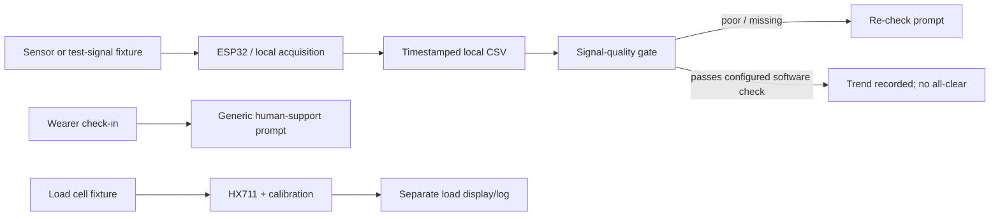

# Hardware and System Plan (Bench Stage)

**Status:** design proposal. Hardware has not yet been acquired or tested. Confirm module voltage levels, interface, measurement range, and cold rating from the exact manufacturer datasheet before wiring.

## Scope decision

Build two modules and evaluate separately:

1. **Offline signal logger:** a sensor board sends data to an ESP32; a local laptop/demo interface displays signal quality and a generic re-check prompt. It does not diagnose disease.
2. **Pack scale fixture:** a load cell and HX711 board measure force at a fixed attachment/bench point. Do not assume one cell measures a backpack accurately during movement; mechanical design and calibration determine that.

Do not build a purported “whole-body monitor.” A wearable can only measure at its sensor locations, and sensor values do not directly establish organ or tissue injury.

## Candidate components (not yet selected or verified)

| Component | Purpose in educational prototype | Limits / checks before purchase |
|---|---|---|
| ESP32 development board | Local microcontroller and BLE/Wi-Fi capability; prototype may keep radios off for offline tests. | Confirm board logic voltage, power draw, battery charging/safety, and temperature range. |
| MAX30102 breakout | PPG waveform experiment for signal-quality processing, if the exact breakout is compatible. | Consumer module; cold, movement, skin contact, fit, and circulation affect signal. Do not use it to diagnose or clear a person. |
| MPU6050 IMU breakout | Motion/artifact context for software experiments. | Needs calibration; acceleration is not a direct fatigue or injury label. |
| DS18B20 probe or suitable contact-temperature sensor | Surface/contact temperature logging on a non-human fixture first. | Surface temperature is not core temperature and cannot diagnose frostbite. Check probe encapsulation, contact, and response time. |
| HX711 amplifier + load cell (capacity selected after mechanical design) | Separate static pack-load measurement rig. | Needs known-mass calibration, stable mounting, overload protection, and repeated placement tests. |
| Known calibration masses / reference scale | Load-cell calibration and cross-check. | Record reference instrument/model and uncertainty. |
| USB power bank or protected battery module | Bench power. | Start on USB bench power; battery/cold operation only after checking cell and protection ratings. |
| Enclosure, straps, wiring, connectors | Safe mechanical assembly. | Avoid sharp edges, snag hazards, exposed conductors, and direct use in field conditions. |

No cost is stated because vendor prices and module quality vary. Choose only after the student confirms a budget ceiling and exact available components.

## Signal path

## Data boundaries

- Keep data on the device/laptop; no account, cloud, GPS, location, unit identity, or tactical details are needed.
- Synthetic data may be used for software checks and must be labelled synthetic in the file and presentation.
- Do not collect health or operational data from serving personnel without formal authorization, consent, supervision, and required review.
- Separate raw sensor data from processed outputs. Preserve original logs and software version for any bench evidence.

