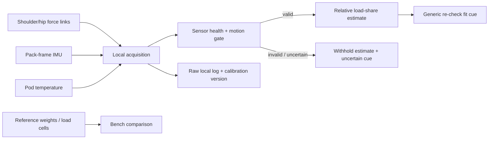

# Hardware and System Plan (Bench Stage)

**Status:** design proposal. The student reports owning one ESP32/Arduino controller only; it is not yet connected to a load sensor. No load sensor, pack rig, or tested hardware prototype is available. Confirm exact part datasheets, mechanical load rating, voltage levels, operating temperatures, and battery safety before purchase or wiring.

### Minimum build to reduce cost and uncertainty

Start with **two shoulder channels on a dummy-pack bench fixture**, not four body-worn channels. Before buying sensors, sketch the force path and have a technically qualified person check the fixture and attachment. A candidate low-cost path is two appropriately rated inline strain-gauge load cells with one HX711 amplifier per channel; a small IMU can be added for controlled movement tests. The exact load-cell range must be chosen from the fixture's maximum expected force and a safety margin, not guessed from the total backpack mass. A temperature sensor, haptic motor, battery and hip channels are later additions. Use USB power and an LED on the bench first. Do not use a person's body or issued military equipment as the initial fixture.

**Starter purchase/borrow list:** (1) two mechanically compatible load cells selected after the force-path review, (2) two compatible HX711 boards, (3) breadboard/jumper leads and a protected mounting fixture, (4) a known-mass reference and a scale whose make/model, resolution and calibration status can be recorded, and (5) optional 6-axis IMU after the static readings work. The existing ESP32 is the controller. Do not buy a battery or haptic motor before the USB bench test. Cheap FSRs are not the first choice for quantitative force measurement because their drift and nonlinearity can obscure the result; they may be used only for a qualitative contact demo.

## Scope decision

### Phase 1: hardware-first pack load-share demonstrator

Build a removable add-on that measures **relative force/load share** at pack support paths and tests whether those readings remain trustworthy under repeatable movement and temperature changes. Start on a dummy pack/test frame. Do not begin with health diagnosis, active load adjustment, or field use.

Candidate measurement points are the left/right shoulder and left/right hip-belt paths. If cost or mechanics make four channels too difficult, prove two shoulder channels on a fixture first and document that narrower scope. A pack-frame IMU and a temperature sensor on the electronics/sensing pod provide motion and hardware-condition context. The temperature sensor is not placed or interpreted as a body-temperature sensor.

The local controller should have three states:

1. **Valid and within the test rule:** log the relative load-share estimate and optionally cue “re-check pack fit/load.”
2. **Valid and outside the test rule:** cue “re-check pack fit/load.” This is not an injury-risk prediction.
3. **Invalid/uncertain:** cue “reading uncertain” or withhold the estimate when the sensor is detached, saturated, drifting, or motion-corrupted.

The exact wording, thresholds, and cue behavior must be validated with a technical adviser; do not use a universal or medical threshold. No automatic strap tightening or pack movement is proposed.

### Separate streams

- The existing Python software demonstrator still processes synthetic signal-quality fields. It is not connected to a real sensor and is not the pack-balance algorithm.
- PPG/body-signal monitoring remains a separate future research question. It is not required to prove Phase 1 and must not be described as a whole-body monitor or diagnostic tool.

## Candidate components (not yet selected or verified)

| Component | Phase-1 role | Limits / checks before purchase |
|---|---|---|
| ESP32 or comparable local controller | Read candidate channels, run the quality gate, store data locally, and drive a simple cue. | Choose exact board only after checking logic level, ADC/interface needs, sleep current, operating temperature, and total mass. Keep radio features off for the core offline demonstration. |
| Two or four load-path force sensors | Candidate inline load/force links at the shoulder straps and/or hip belt. | Compare inline load cells with flexible pressure elements. Check stiffness, hysteresis, zero drift, dynamic range, overload protection, mounting safety, and whether the sensor itself changes fit. Do not call uncalibrated values “pressure.” |
| Load-cell amplifier(s), if strain-gauge links are selected | Convert the chosen force-sensor signal for local acquisition. | Channel count and amplifier depend on the final sensors. Verify calibration, noise, temperature dependence, and mechanical fixture before integrating. |
| Pack-frame IMU | Tag static vs moving intervals and test motion-related estimate failure. | Calibrate orientation and sampling; motion is context only, not fatigue or injury. |
| Pod/sensor temperature sensor | Record the hardware’s test temperature to study drift and validity. | Select location and range from the datasheet; this is not a human-body or core-temperature measurement. |
| Haptic/status cue | Give short “re-check” or “uncertain” feedback without relying on a phone. | Check current draw, glove usability on a fixture, audibility/tactility, and avoid alert fatigue. No tactical or medical message. |
| Local logger / flash storage | Preserve raw samples, timestamps, calibration and software version. | Retain raw data; protect privacy; no GPS, cloud, soldier identity, or operational details are needed. |
| Reference weights / calibrated reference load cells | Provide bench ground truth for each sensor path and verify the total. | Record instrument identity, calibration date, range, resolution, and uncertainty. Do not treat synthetic data as reference data. |
| Enclosure, removable mounts, strain relief, wiring | Protect the pod and keep sensor links removable from a civilian test pack. | Avoid sharp parts, snag hazards, stiff contact edges, water ingress and changes that could alter a real issued pack. |
| Protected battery, selected after power budget | Portable supply after USB-powered bench operation works. | Weigh the complete system. Verify cell protection and manufacturer temperature limits; do not cold-test a battery outside its permitted conditions. |

**Provisional mass goal:** aim for no more than 150 g for all add-on sensors, electronics, battery, housing, mounts and cables. This is a design constraint to test, not a measured specification. Revisit it if the chosen force links cannot meet it safely.

## Candidate signal path

The physiological wearable is not in this signal path. This separation prevents the system from mixing an unvalidated health signal with an unvalidated pack-balance signal.

## Bench validation sequence

1. **Mechanical check:** verify the fixture and mounts withstand the selected safe test loads; no person carries the prototype during this step.
2. **Calibration:** determine each channel’s zero, span, hysteresis, repeatability, and overload behavior against a documented reference.
3. **Known distributions:** use the same total test mass in balanced and deliberate left/right and shoulder/hip arrangements. Repeat each configuration after unloading and refitting.
4. **Motion and fault injection:** compare stationary and repeatable fixture movement; intentionally disconnect, loosen, saturate, or offset one sensor to check the invalid-data gate.
5. **Temperature:** use a suitable environmental chamber and remain within the operating limits of every component. Log temperature at the sensor, not just room setpoint. Do not expose people to dangerous cold or batteries to unapproved temperatures.
6. **Baseline comparison:** compare total-weight-only and simple-threshold baselines with the proposed multi-point estimate plus quality gate. Freeze the metrics and thresholds before reviewing outcomes.
7. **Mass and power:** weigh the complete removable kit and measure runtime on the bench. Report failures and missing data.

Report relative load-share error against reference, repeated-fit variation, drift/hysteresis, valid-data coverage, sensor-fault detection, false prompts, missed scripted imbalance cases, alert delay, total mass, and runtime. Select numerical acceptance limits only after the sensor and reference equipment are known and a technical adviser reviews the protocol; these limits are not medical standards.

## Data and use boundaries

- Start with a civilian backpack, a dummy load, and a static/mechanical fixture. No serving-soldier test or modification of issued kit without formal authorization.
- No user identity, body-health profile, GPS, route, unit, or operational data are needed for the core project.
- Keep raw and processed logs separate; record date, configuration, calibration, code version, and failures.
- Do not claim reduced pack weight, improved endurance, injury prevention, safety clearance, or soldier benefit until directly measured with an appropriate study.
- Do not add machine learning until a defined, non-medical task and enough independently labeled data exist. A transparent baseline is the right first comparison.

For prior-art comparison and the proposed novelty hypothesis, see [`novelty_research_gap_v2.md`](novelty_research_gap_v2.md).
